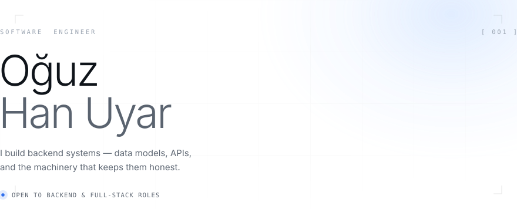

<picture>
  <source media="(prefers-color-scheme: dark)" srcset="assets/hero-dark.svg">
  
</picture>

<br>

```console
oguz@theoguz16 ~ $ whoami
oğuz han uyar

oguz@theoguz16 ~ $ cat role.txt
backend engineer · apis · data models · systems that stay honest
```

```console
oguz@theoguz16 ~ $ ls ~/work
```

| <sub>repo</sub> | <sub>what</sub> |
|:--|:--|
| [`fizyoterapi-saas`](https://github.com/theOguz16/fizyoterapi-saas) | multi-tenant clinic platform — web, mobile, RBAC, subscriptions |
| [`bounded-dllm-agent-lab`](https://github.com/theOguz16/bounded-dllm-agent-lab) | agentic runtime with bounded authority and deterministic verification |
| [`ShopAI`](https://github.com/theOguz16/ShopAI) | commerce discovery monorepo — contracts, API, workers |
| [`trionn-clone`](https://github.com/theOguz16/trionn-clone) | motion and 3D interaction study |
| [`fed-edge-moe`](https://github.com/theOguz16/fed-edge-moe) | federated inference across heterogeneous edge devices |

```console
oguz@theoguz16 ~ $ cat status.txt
open to backend & full-stack roles
```

<sub>[oguzhanuyar531@gmail.com](mailto:oguzhanuyar531@gmail.com) &nbsp;·&nbsp; [fizyoflow.com](https://fizyoflow.com) &nbsp;·&nbsp; [github](https://github.com/theOguz16)</sub>
