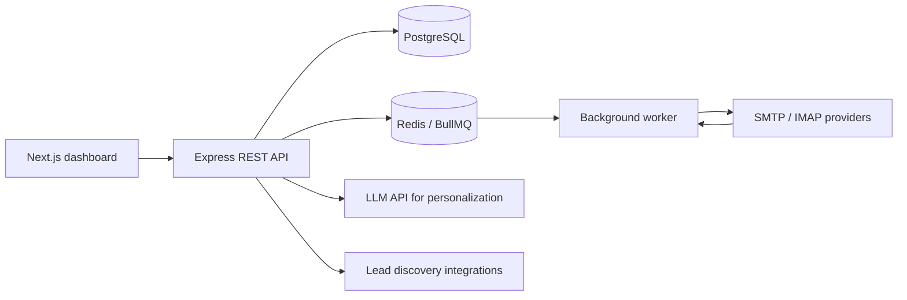

# MailLooper — SaaS Backend & Automation Case Study

> **Portfolio case study · Source repository is private**  
> **Role:** Founder / full-stack developer  
> **Focus:** Backend systems, asynchronous jobs, external integrations, SaaS workflows

## Product problem

Outbound-email workflows combine lead discovery, message personalization, scheduled campaigns, and ongoing inbox synchronization. Running each of these operations inside an HTTP request can make the system slow, fragile, and difficult to manage.

MailLooper explores an integrated web application for these workflows, with background processing separated from interactive API requests.

## System overview

**Primary stack:** Next.js, React, Node.js, Express.js, PostgreSQL, TypeORM, Redis, BullMQ, Docker, SMTP/IMAP, and LLM API integration.

This diagram is intentionally high-level; it omits private deployment configuration and provider credentials.

## Engineering responsibilities

- Designed backend endpoints and persistence for outreach-related workflows.
- Worked on queue-backed campaign processing and scheduled email activities using Redis / BullMQ.
- Integrated mail-provider protocols for sending messages and synchronizing replies.
- Added AI-assisted content personalization and lead-discovery integrations.
- Built a web dashboard for managing campaigns and operational state.
- Documented deployment and operational smoke-test workflows.

## Design decisions and trade-offs

| Concern | Engineering approach |
| --- | --- |
| Slow external calls | Separate background jobs from request/response APIs |
| Campaign state | Persist business state in PostgreSQL; coordinate scheduled work with Redis / BullMQ |
| Provider differences | Keep email transport and synchronization distinct from core campaign workflows |
| AI content | Treat model output as an integration rather than the source of application authority |
| Operational confidence | Maintain scripted smoke checks for campaign and related workflows |

The repository includes operational checklists and smoke-test scripts. Their presence does **not** establish a production reliability or delivery-rate benchmark.

## What this work demonstrates

Practical experience building **stateful backend services, job queues, database-backed SaaS workflows, and external API integrations**, rather than only assembling a frontend.

## Status and disclosure

The implementation repository remains **private**. This page describes the engineering scope at a high level; it does not include source code, credentials, customer information, usage figures, or unverified performance claims.

No claim of commercial scale, deliverability performance, or current production traffic is made here.
