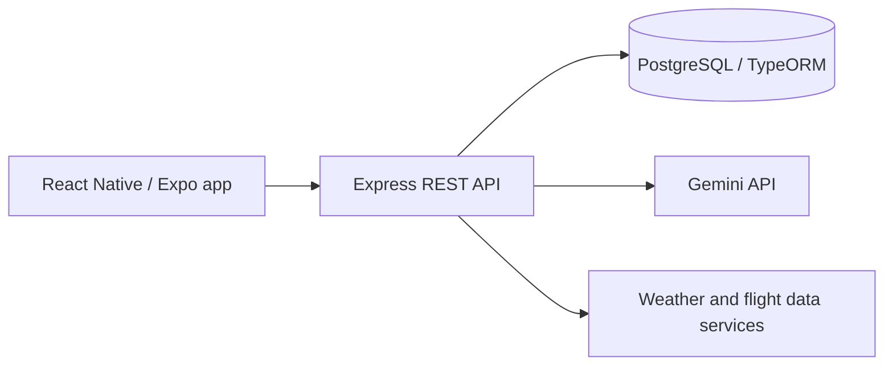

# Routy — AI-Assisted Travel Planning Case Study

> **Portfolio case study · Implementation repositories are private**  
> **Role:** Mobile and backend developer  
> **Context:** Four-person TÜBİTAK 2209-B project with academic and industry guidance  
> **Focus:** Mobile development, API design, AI integration, and third-party data

## Product problem

Planning a trip involves combining destination preferences, budget, trip details, weather, and travel information. Routy explores a mobile-first experience that brings these inputs together to generate and manage personalized travel plans.

## System overview

**Primary stack:** React Native, Expo, Node.js, Express.js, PostgreSQL, TypeORM, JWT, Gemini API, and third-party travel services.

This simplified diagram describes the main integration boundaries; it is not a deployment or security audit.

## Engineering responsibilities

- Built mobile application flows for entering travel preferences and accessing saved plans.
- Developed Express REST services and PostgreSQL data models.
- Implemented user authentication and travel-plan management.
- Integrated Gemini API for AI-assisted itinerary generation.
- Connected third-party data sources for weather and flight-related information.
- Prepared and published an Android release on Google Play.

## Engineering considerations

| Concern | Approach |
| --- | --- |
| Personalization | Collect structured preferences and travel constraints before AI generation |
| State management | Persist user and itinerary data in the backend |
| External dependencies | Keep model and travel-provider calls behind the API |
| Mobile distribution | Work through Android packaging and store release workflows |

External data may vary in freshness or coverage. This case study does not claim real-time booking, guaranteed itinerary accuracy, or measured model-quality improvements.

## What this work demonstrates

Experience delivering **an end-to-end mobile product**, with responsibilities spanning client interfaces, REST APIs, persistence, AI services, integration boundaries, and application distribution.

## Status and disclosure

The underlying application and backend repositories remain **private**. This page contains only a high-level account of the project and does not reveal credentials, private implementation details, user data, or unverified metrics.
